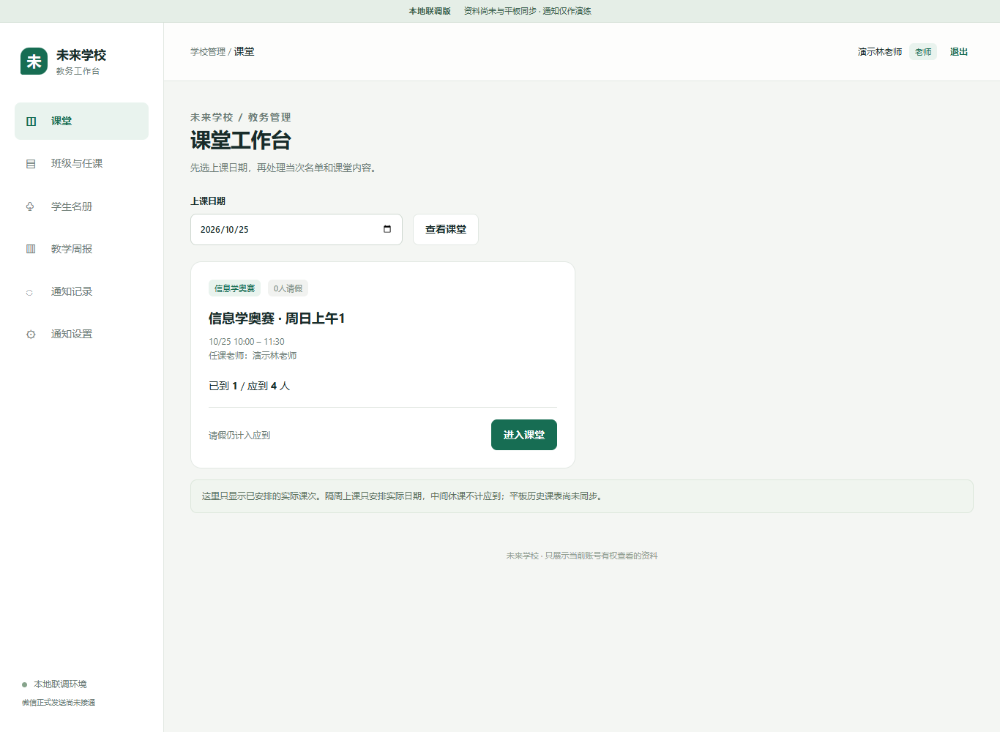
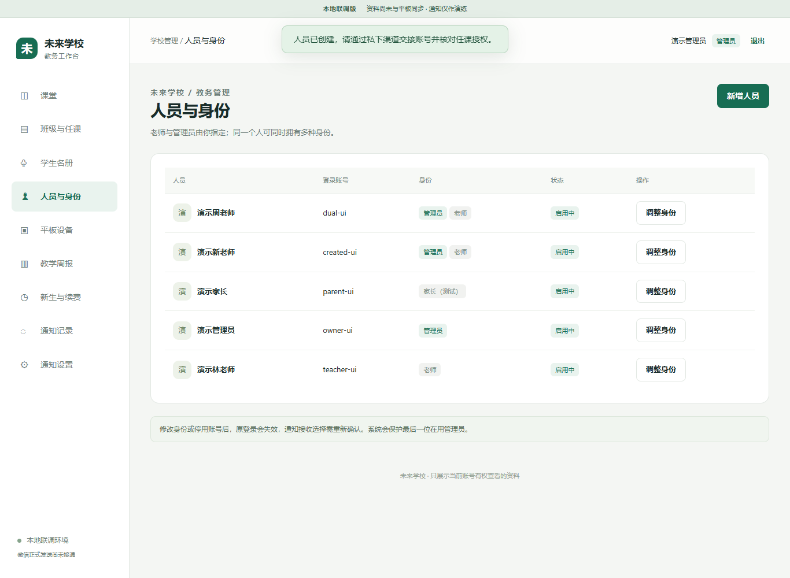

# 未来学校学生管理系统

面向培训机构的学生签到与教务管理系统，由 **安卓平板 App** 和 **网页工作台** 组成。学生可以在平板上离线签到，教师和管理员通过网页处理考勤与教务。已接入同步的班级可在两端查看考勤变化。

## 系统功能

| 使用场景 | 主要功能 |
| --- | --- |
| 平板签到 | 支持离线人脸识别、姓名和学号签到，记录签到时间并扣减课时 |
| 学生与班级管理 | 管理学生档案、在读状态和课时余额，按课程组织班级，支持每周及隔周排课、调课和加课 |
| 教师工作台 | 查看本人任课班级的今日课程及历史签到名单，提交补签和请假申请 |
| 管理员工作台 | 管理人员、角色和班级任课，审核补签和请假，查看本周及历史周报 |
| 统计与备份 | 按班级和教师统计到课率，跟踪课时变动，支持 Excel 导入导出和完整备份 |

家长微信绑定与签到通知正在接入中。

## 界面截图

以下截图使用演示数据。网页截图来自联调环境。

### 平板签到

### 平板工作台与班级管理

### 教师网页工作台

### 网页人员与身份管理

### 到课率周报

[开发日志](CHANGELOG.md)
